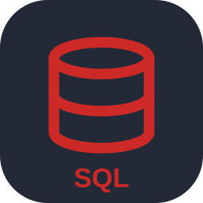
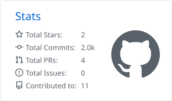
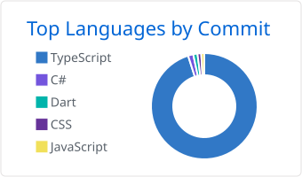

  <picture>
    <source media="(prefers-color-scheme: dark)" srcset="./assets/hero-dark.svg" />
    
  </picture>

  
  

## Featured work

Production systems built for client companies. Code is private; numbers are from the real projects.

<picture>
  <source media="(prefers-color-scheme: dark)" srcset="./assets/projects/case-platform-dark.svg" />
  
</picture>

<b>Problem &amp; what I built</b>

**Problem.** A 2019-era PHP/MySQL case system could not page its case lists, had hard-coded permissions and no SLA tracking. With real data, loading all cases took more than 6 minutes and timed out.

**What I built — solo, design to deploy:**
- NestJS 11 + Prisma REST API on SQL Server (176 endpoints) and a React 19 + TypeScript front end with Kanban, list, calendar and report views; per-screen permissions for 4 roles.
- Incremental ETL (MySQL → SQL Server) using watermarks and staging-table `MERGE`, re-syncing while the old system stayed live, with a final reconcile on cutover day.
- Server-to-server integration with an internal project-management platform, SLA/status email alerts, and an AI copilot over case data with switchable LLM providers.

**Results:** 69,681 cases, 338,298 case events and 962 users migrated — 22 tables reconciled with 0 errors · case-list API 6+ min → 145 ms · Kanban first render ~5 s → ~0.4 s · 1,959 automated tests.

<picture>
  <source media="(prefers-color-scheme: dark)" srcset="./assets/projects/warehouse-dark.svg" />
  
</picture>

<b>Problem &amp; what I built</b>

**Problem.** Warehouse and shop-floor staff keyed receipts, shipments, transfers, counts and production output into the ERP by hand at a desk — slow and error-prone, with no mobile way to check stock or bins.

**What I built — top contributor in a team of 4–5:**
- Next.js handheld web app with camera barcode/QR scanning covering 20+ warehouse and production flows, from goods receipt to cycle counts and shop-floor output.
- Express + Sequelize API that syncs master data and open documents from Business Central on schedules (including delta sync of changed lines) and posts scanned lines back, logging every post attempt for audit.
- One codebase for several client companies: per-site settings and feature flags, page-level Save/Post/Delete permissions, location-scoped access, login lockout, versioned migrations with a schema audit.

**Results:** live in production for multiple client companies · 2,650 automated tests.

<picture>
  <source media="(prefers-color-scheme: dark)" srcset="./assets/projects/marketplace-erp-dark.svg" />
  
</picture>

<b>Problem &amp; what I built</b>

**Problem.** Orders, returns and payouts from each marketplace were keyed into the ERP by hand, shop by shop — slow, error-prone and hard to reconcile.

**What I built — lead backend developer (~84% of commits):**
- Multi-tenant Node.js/Express backend connecting Shopee, Lazada and TikTok Shop via OAuth with automatic token refresh, turning their data into Business Central Sales Orders, Return Orders and Cash Receipts.
- Per-shop schedulers with independent sync intervals and checkpoints stored in the database, so a sync resumes where it stopped; an export queue posts to Business Central (NTLM) and logs every call.
- Pre-deploy guard scripts that verify tenant data isolation, the payload shape sent to Business Central, and shop on/off feature wiring.

**Results:** 3 marketplaces → 1 ERP, with automatic and on-demand sync.

## Tech stack

**Frontend** &nbsp;

**Backend &amp; data** &nbsp;

**Tools &amp; mobile** &nbsp;

## GitHub stats

  <picture>
    <source media="(prefers-color-scheme: dark)" srcset="./profile-summary-card-output/github_dark/3-stats.svg" />
    
  </picture>
  <picture>
    <source media="(prefers-color-scheme: dark)" srcset="./profile-summary-card-output/github_dark/2-most-commit-language.svg" />
    
  </picture>

