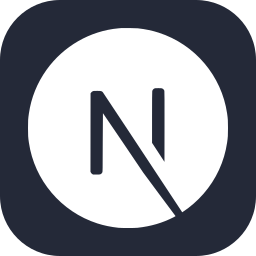
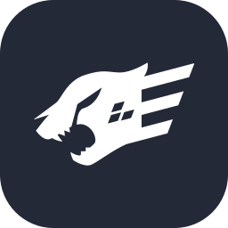
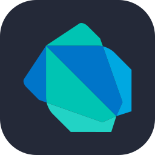
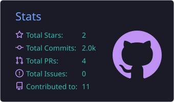
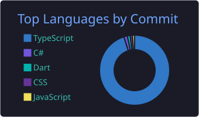

<div align="center">
  
</div>

<p align="center">
  <a href="https://github.com/panutthon"></a>
  
  <a href="mailto:panutthon.cc@hotmail.com"></a>
</p>

<p align="center">
  <em>Full Stack Developer · ERP & E-commerce Integration</em><br/>
   Bangkok, Thailand
</p>

---

##  About Me

```javascript
const panutthon = {
  name: "Panutthon Chanachon",
  location: "Bangkok, Thailand",
  role: ["Full Stack Developer", "ERP Systems Engineer"],
  stack: {
    frontend: ["React (Vite)", "Next.js", "TypeScript", "JavaScript", "Tailwind CSS"],
    backend: ["Node.js", "Express", "Fastify", "NestJS"],
    database: ["PostgreSQL", "MS SQL Server"],
    mobile: ["Flutter", "Dart"],
    other: ["C#", "Python", "PHP", ".NET"],
  },
  currentlyWorkingOn: [
    "ERP dashboards & internal tooling",
    "Multi-platform e-commerce ↔ ERP integrations (Shopee / Lazada / TikTok Shop)",
  ],
  passions: ["Clean Architecture", "Performance Optimization", "Developer Tooling"],
};
```

---

##  Tech Stack

**Frontend**<br/>





**Backend & Database**<br/>





**Mobile & Tools**<br/>




---

##  What I Build

-  **ERP Dashboard** – React + TypeScript dashboard with data visualization (Recharts)
-  **E-commerce ↔ ERP Integration** – Syncing orders, finance and logistics from Shopee / Lazada / TikTok Shop into a central ERP
-  **Internal Tooling** – Node.js services for team automation and internal workflows

---

##  GitHub Stats

<p align="center">
  
  
</p>

<p align="center">
  
</p>

---

##  Let's Connect

Happy to collaborate or exchange ideas on **web accessibility**, **performance optimization** and **developer tooling**.

<p align="center">
  <a href="mailto:panutthon.cc@hotmail.com"></a>
  <a href="https://github.com/panutthon"></a>
</p>

<div align="center">
  <blockquote>
    "Clean code isn't just about syntax—it's about crafting solutions that solve real problems<br/>
    while remaining accessible to other developers."
  </blockquote>
</div>

<div align="center">
  
</div>
